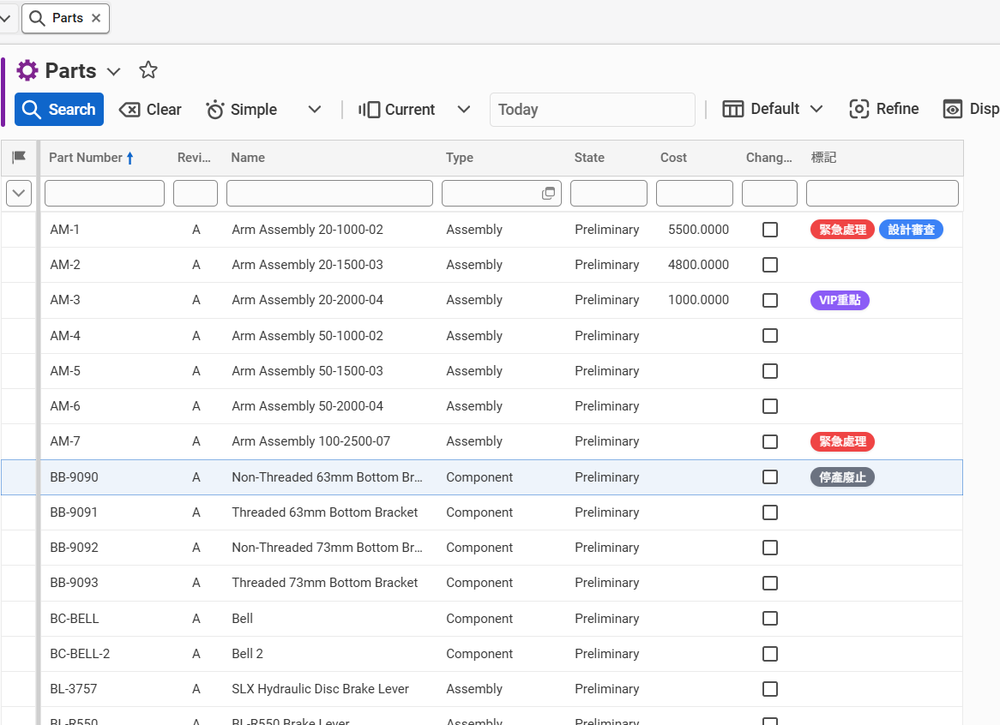

# Aras Innovator R36 - Client Form Multi-Label Field (`bcs_label`) 元件

本專案為 **Aras Innovator R36** 開發的自訂前端表單標籤選擇器（Multi-Label / Tag Chips Field）。
支援自訂色彩、**Aras 原生多語系（Multilingual / I18N）**、排序、即時搜尋過濾，並以自訂 ItemType **`bcs_label`** 與關聯表 **`bcs_label_tags`** 作為標籤來源目錄，資料以 **JSON 陣列字串**儲存於目標文字欄位。

---

## 目錄
1. [功能特點](#功能特點)
2. [資料模型與儲存格式](#資料模型與儲存格式)
3. [多語系 (I18N) 運作機制](#多語系-i18n-運作機制)
4. [Aras Innovator R36 安裝與設定指引](#aras-innovator-r36-安裝與設定指引)
   - [步驟 1：匯入或建立 `bcs_label` 與 `bcs_label_tags`](#步驟-1匯入或建立-bcs_label-與-bcs_label_tags)
   - [步驟 2：在目標 ItemType 建立文字欄位](#步驟-2在目標-itemtype-建立文字欄位)
   - [步驟 3：在 Form 放置 HTML Field](#步驟-3在-form-放置-html-field)
   - [步驟 4：設定 Form Event (`onFormPopulated`)](#步驟-4設定-form-event-onformpopulated)
5. [本機開發與測試](#本機開發與測試)
   - [單元測試 (Unit Tests)](#單元測試-unit-tests)
   - [瀏覽器模擬展示 (E2E Demo)](#瀏覽器模擬展示-e2e-demo)
6. [GitHub 版本控管與上傳指引](#github-版本控管與上傳指引)

---

## 功能特點
- 🌐 **全方位多語系感知 (Multilingual / I18N)**：深度整合 Aras Web Client Session 語系，依使用者登入語系（如 `zh-TW`, `zh-CN`, `en`, `ja`）動態呈現對應標籤文字與搜尋索引。
- 🎨 **色彩感知標籤徽章 (Color Badges)**：標籤依據 `color` 欄位渲染，自動計算最佳黑/白文字對比色，視覺層次清晰。
- 🔍 **智慧過濾下拉選單**：輸入文字即時過濾可用標籤（支援按 Name 或當下語系 Label 搜尋），並支援鍵盤上下鍵與 Enter 選取。
- 📦 **結構化多語系 JSON 儲存 (Option B)**：以標準 JSON 陣列儲存標籤元數據 (`name`, `label`, `labels: { [lang]: string }`, `color`, `sort_id`)，完整保留多語系與樣式資訊。
- 🔒 **表單狀態聯動**：完美支援 Aras R36 生命週期，View Mode 自動切換為純徽章唯讀，Edit Mode 允許選取與刪除。
- ⚡ **零相依原生架構**：採用 Vanilla JavaScript (ES6+) 與現代 CSS，嚴格遵循 S.O.L.I.D 原則。

---

## 多語系 (I18N) 運作機制
1. **來源定義 (`bcs_label_tags.label`)**：
   - 欄位型態設定為 `ml_string`（多語系字串）。管理員可以在後台分別維護各語言的顯示名稱（例如繁中「緊急處理」、簡中「紧急处理」、英文「Urgent Action」）。
2. **Client 端自動偵測**：
   - 前端適配器透過 `aras.getSessionContext().getLanguageCode()` 取得使用者當前語系代碼（例如 `zh-TW`）。
3. **優雅退回（Fallback）原則**：
   - 當前語系精確比對（如 `zh-TW`） -> 基礎語言代碼比對（如 `zh`） -> 實體預設名稱（`label`） -> 英文（`en`） -> 標籤唯一代碼（`name`）。

---

## 資料模型與儲存格式

### 標籤來源模型 (`bcs_label`)
- **主表 ItemType**: `bcs_label`
  - `name` (String, 長度: 64) - 標籤分類目錄名稱（如 `Part_Labels`）
- **關聯表 Relationship**: `bcs_label_tags`
  - `sort_id` (Float) - 排序序號
  - `name` (String, 長度: 32) - 標籤鍵值代碼（例如 `urgent`）
  - `label` (Multilingual String `ml_string`, 長度: 64) - 各語系顯示文字
  - `color` (Color / String, 長度: 32) - 色彩十六進制代碼（例如 `#EF4444`）

### 目標文字欄位儲存格式 (多語系 JSON)
```json
[
  {
    "name": "urgent",
    "label": "緊急處理",
    "labels": {
      "zh-TW": "緊急處理",
      "zh-CN": "紧急处理",
      "en": "Urgent Action"
    },
    "color": "#EF4444",
    "sort_id": 1.0
  },
  {
    "name": "design",
    "label": "設計中",
    "labels": {
      "zh-TW": "設計中",
      "zh-CN": "设计中",
      "en": "In Design"
    },
    "color": "#3B82F6",
    "sort_id": 2.0
  }
]
```

---

## Aras Innovator R36 安裝與設定指引

### 步驟 1：匯入或建立 `bcs_label` 與 `bcs_label_tags`
提供兩種方式建立此模型：

#### 方式 A：透過 AML 快速匯入（推薦）
在 Aras nash Client 的 **Apply AML** 依序執行以下兩步驟：
1. **建立模型結構 (Schema)**：
   複製專案中 `src/aras/aml/bcs_label_ItemType.xml` 內容並執行，建立 `bcs_label` 主表、`bcs_label_tags` 關聯 ItemType 及 `RelationshipType`。
   *(注意：在 AML 中請勿自行填寫自訂字串 ID，Aras 會自動生成符合規範的 32 碼 Hex GUID)*
2. **匯入預設範例資料 (Sample Data)**：
   在模型結構建立完成後，複製 `src/aras/aml/bcs_label_SampleData.xml` 內容執行，建立 `Part_Labels` 目錄與預設的 5 筆彩色標籤。

#### 方式 B：手動介面建立
1. **建立主表 ItemType**:
   - 進入 **Administration > ItemTypes** > 建立新項目。
   - Name: `bcs_label`，Label: `標籤目錄`。
   - 在 Properties 中確認/新增 `name` (String, 64)。
2. **建立關聯 Relationship**:
   - 切換至 **RelationshipTypes** 頁籤，新增關聯 `bcs_label_tags`。
   - 關聯表屬性新增：
     - `sort_id` (Float)
     - `name` (String, 32)
     - `label` (Data Type 選 `ml_string`, 長度 64)
     - `color` (Color, 32)
3. **建立標籤資料**:
   - 進入 **TOC > 標籤目錄 (bcs_label)**，新增一筆如 `Part_Labels`。
   - 在其 `bcs_label_tags` 關聯頁籤新增多筆彩色標籤，並於多語系介面分別鍵入繁中、英文等文字後儲存解鎖。

### 步驟 2：在目標 ItemType 建立文字欄位
在需要使用標籤的 ItemType（例如 `Part` 或自訂 ItemType）：

#### 方式 A：透過 AML 快速建立（最推薦，5 秒完成）
在 Aras nash Client 的 **Apply AML** 貼入並執行 `src/aras/aml/add_labels_property_to_Part.xml`：
```xml
<AML>
  <Item type="Property" action="add">
    <source_id>4F1AC04A2B484F3ABA4E20DB63808A88</source_id>
    <name>labels</name>
    <label xml:lang="zh-TW">標記</label>
    <label xml:lang="en">Labels</label>
    <data_type>text</data_type>
    <is_hidden>0</is_hidden>
    <is_hidden2>0</is_hidden2>
  </Item>
</AML>
```

#### 方式 B：手動介面建立
1. 進入 **Administration > ItemTypes**，搜尋並開啟 `Part`。
2. 點擊 **Edit** 鎖定。
3. 切換至 **Properties** 頁籤，新增一列：
   - **Name**: `labels`
   - **Label**: `標記`
   - **Data Type**: `Text`
4. 點擊 **Save** 並 **Done** 解鎖 ItemType。

### 步驟 3：在 Form 放置隱藏原生欄位與 HTML Field（隱藏屬性綁定技巧）
> [!IMPORTANT]
> **Aras 表單核心機制注意**：在 Aras Innovator 中，若表單上「未存在該屬性之 Field 節點」，Aras 表單引擎在載入（Get）與儲存（Save）時將不會自動將該屬性打包傳遞。因此需要採用 Aras 官方標準的「隱藏屬性技巧（Hidden Property Technique）」，在 Form 上放置一個隱藏的原生 `labels` 欄位作為底層資料通道。

1. 進入該 ItemType 的 Form 編輯畫面（例如 `Part` 表單）。
2. **放置原生 `labels` 欄位並設為隱藏**：
   - 從左側未使用的屬性清單（Unused Properties）中將 **`labels`** 拖入表單編輯區。
   - 點選該 `labels` 欄位，在左下角屬性面板中切換至 **Field Physical** 頁籤。
   - 將 **Visible** 屬性改為 **False**（取消勾選，隱藏該原生文字框）。
3. **放置自訂 HTML Field**：
   - 在表單工具列拖入一個 **HTML Field**（放置在您希望呈現標籤的位置，如右上角）：
     - **Field Name**: `field_bcs_labels`
     - **Field Label**: `標籤 (Labels)`
     - **Field Type**: `html`
   - 點擊該欄位之 **HTML Code**，貼入 `src/aras/Form_MultiLabel_Field.html` 中的完整程式碼。

### 步驟 4：設定 Form Event (`onFormPopulated`)
1. 在 Form 的 **Form Events** 頁籤新增事件關聯：
   - **Event**: `onFormPopulated`
   - **Method Name**: `bcs_init_multi_label_field`
2. Method 內容參照 `src/aras/Method_initMultiLabel.js`：
   ```javascript
   // 初始化多標籤欄位
   if (window.initBcsMultiLabelField) {
     window.initBcsMultiLabelField({
       containerId: "bcs_label_container",
       propertyName: "labels",              // 目標儲存屬性
       labelCategoryName: "Part_Labels"    // bcs_label 的目錄名稱
     });
   }
   ```
3. 儲存並解鎖 Form。

### 步驟 5：設定後端 Multi-Tags 模糊搜尋轉譯器 (Server Method - onBeforeGet)
1. **建立 / 更新 Server Method (`bcs_label_search_handler`)**：
   - 進入 **Administration > Methods**，搜尋或新增 Method：
     - **Name**: `bcs_label_search_handler`
     - **Method Type**: `C#`
     - **Code**: 複製 `src/aras/server/bcs_label_search_handler.cs` 的最新程式碼並儲存（具備全語系標籤目錄讀取、雙重安全補查與代碼精準模糊匹配）。
2. **在目標 ItemType 掛載 Server Event**：
   - 開啟目標 ItemType（如 `Part`）。
   - 切換至 **Server Events** 頁籤，確認或新增事件關聯：
     - **Event**: `onBeforeGet`
     - **Related Method**: 選擇 `bcs_label_search_handler`
   - 儲存 ItemType。
> [!IMPORTANT]
> **搜尋結果校驗注意**：若搜尋框已顯示標籤，但搜尋結果仍查出其他不符合標籤的項目，請務必確認已將最新的 `src/aras/server/bcs_label_search_handler.cs` 貼回 Aras 的 Method 中，且該 Method 已成功關聯至 Part 的 `onBeforeGet` 事件。

### 步驟 6：設定 Main Grid 彩色徽章渲染與搜尋列選擇器 (Client Method)
解決 Main Search 網格中 JSON 原始內容不易閱讀、以及搜尋欄無法點擊挑選標籤的問題。最新版支援**四層深度模型同步 (Deep Query Sync)**，在點選標籤套用時直接注入 `currQryItem`、`searchContainer.searchMode` 與 `grid.head`，確保 Aras 查詢引擎 100% 收到最新條件：

1. **建立 Client Method (`bcs_main_grid_extension`)**：
   - 進入 **Administration > Methods**，新增 Method：
     - **Name**: `bcs_main_grid_extension`
     - **Method Type**: `JavaScript`
     - **Execution Mode**: `Client`
     - **Code**: 複製 `src/aras/client/bcs_main_grid_extension.js` 的完整程式碼並儲存（已消除 TypeScript linter 警告）。
2. **掛載至 Main Grid（選擇以下任一種標準途徑）**：
   > [!NOTE]
   > **架構說明**：ItemType 的 **Client Events** 頁籤只有項目實體生命週期（`OnBeforeNew`, `OnNew`, `OnAfterNew`, `OnShowItem`），**無主網格的 `onLoad`**。請使用以下方式掛載：

    - **途徑 A（最推薦！100% 全自動零手動）：在 CUI CommandBarSection 掛載為 Init Method**：
      - **效果**：使用者在 TOC 點擊「Parts」開啟主搜尋畫面的一瞬間，系統自動初始化並彩化單元格、掛載搜尋框 Popover，完全無需手動點擊任何 Action！
      - **設定步驟 (Aras R36 實戰精確欄位)**：
        1. 進入 **Administration > Configuration > Client Presentation**，開啟 **`Global`**。
        2. 在下方 **Command Bar Section** 頁籤中搜尋並開啟 **`searchview.commandbar.default`**（主搜尋網格工具列）。
        3. 點擊 **Edit** 鎖定，切換至 **Command Bar Item** 頁籤，新增一筆資料並設定以下精確欄位：
           - **ItemType**: 選擇 `Button`
           - **Name**: 輸入 `bcs_main_grid_auto_init`
           - **Init Method**: 選擇 Method `bcs_main_grid_extension`
           - **Action**: 選擇 `Add`
           - **For Identity**: 選擇 `World`
        4. 點擊 **Save** 並點擊 **Done** 解鎖。
        5. 按 `F5` 重新整理瀏覽器。此後進入 Parts 主搜尋畫面即可 100% 全自動彩化並掛載標籤浮層！

    - **途徑 B（手動備用按鈕）：在 ItemType 的 Actions 頁籤掛載**：
      - 開啟目標 ItemType（如 `Part`），於 **Actions** 頁籤新增動作 `bcs_main_grid_extension`，作為手動強制觸發或測試使用。
   - **途徑 C（3秒即時預覽）：在瀏覽器 Console 執行**：
     - 在 Part 搜尋畫面按 `F12` 打開開發者工具的 **Console**。
     - 貼上 `src/aras/client/bcs_main_grid_extension.js` 代碼並按 Enter，即可瞬間看到彩化與搜尋列按鈕！

3. **完成效果與方案 A 操作指南**：
   - 🎨 **網格即時彩化**：列表中「標記」欄位的生硬 JSON 字串自動轉化為美觀易讀的彩色標籤徽章 (Chips)！
   - 🔍 **搜尋列彩色標籤多選浮層 (方案 A)**：
     - **開啟方式**：在 Main Search 網格最上方搜尋列的「標記」輸入框點擊任意處，或點擊右側的標籤圖示按鈕。
     - **挑選標籤**：浮層展開後，會列出所有可用的彩色標籤（與 Form 表單色票完全一致），可勾選一個或多個標籤。
     - **邏輯切換**：上方提供「且 (AND)」與「或 (OR)」切換按鈕，預設為「且 (AND)」交集查詢。
     - **套用搜尋**：點擊「套用搜尋」或直接按下 Enter 鍵，系統會自動將標籤組合為條件填入搜尋框，並自動觸發主網格搜尋！
     - **快速清空**：點擊浮層左下角的「清空」按鈕，立即重設已選標籤與輸入框條件。
    - 🛡️ **Virtual DOM 零破壞防錯位架構**：嚴禁清空單元格 DOM 子節點，保留原生 TextNode 供 Inferno.js diffing 演算法比對，徹底根除欄位拖拉時拋出的 NotFoundError 與單元格錯位覆蓋其他欄位（如 State）的重大問題。
    - 🏷️ **純淨 TextNode 防污染渲染 (Anti-Contamination)**：提取單元格原生 JSON 時自動排除既有徽章容器文字干擾，徹底解決反覆搜尋或切換資料時因文字拼接導致 JSON.parse 報錯與標籤值卡死不更新問題。
    - ⚡ **搜尋條件四層深度同步**：在套用或更換條件時，自動與 currQryItem、searchContainer.searchMode 及 grid.head 保持雙向同步，支援反覆搜尋、條件替換與快速清空。


---

## 本機開發與測試

### 單元測試 (Unit Tests)
本專案提供核心資料模型與狀態管理、多語系解析之單元測試：
```bash
node --test tests/unit/LabelTag.test.js tests/unit/LabelStore.test.js
```

### 瀏覽器模擬展示 (E2E Demo)
在 `tests/demo/index.html` 內嵌了模擬 Aras Client 環境：
1. 具備模擬的 `bcs_label` / `bcs_label_tags` 資料來源（含中英文等多語系）。
2. 支援即時切換 Session 語系（`zh-TW` / `en` / `zh-CN`），觀察標籤與下拉選單動態更新。
3. 支援切換 View Mode (唯讀) 與 Edit Mode (可編輯)。
4. 即時顯示目標文字欄位的多語系 JSON 儲存內容。

---

## GitHub 版本控管與上傳指引

本專案第一版開發完成後，透過 GitHub CLI (`gh`) 建立遠端儲存庫並推送：
```bash
git init
git add .
git commit -m "feat: initial commit of Aras Innovator R36 multi-label field component with multilingual support"
gh repo create aras-label --public --source=. --remote=origin --push
```
