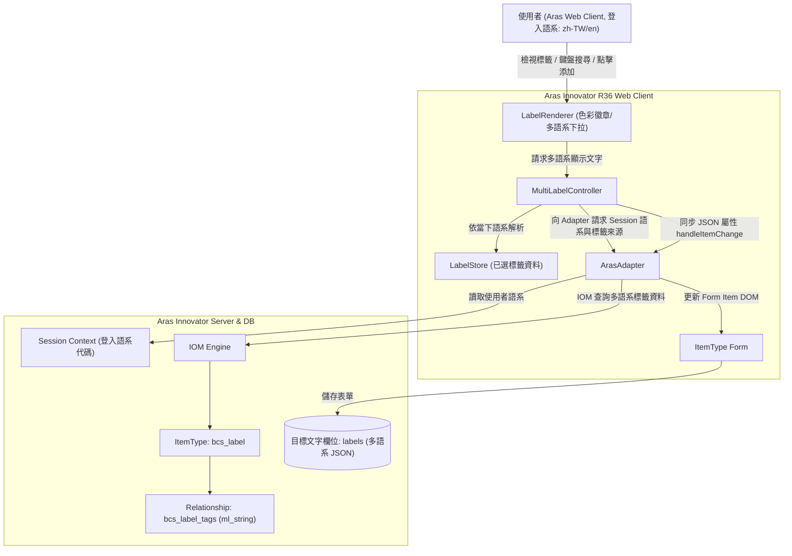
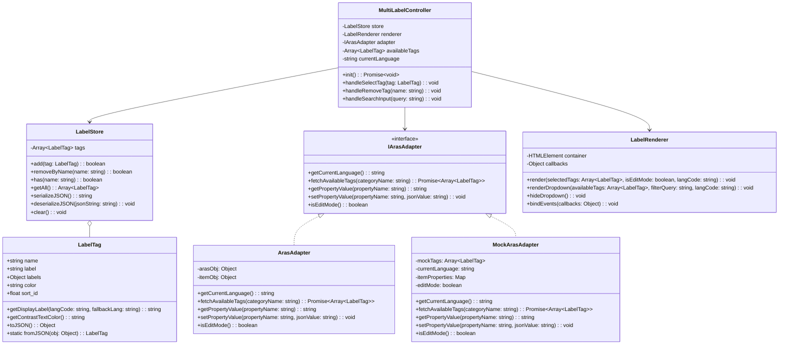
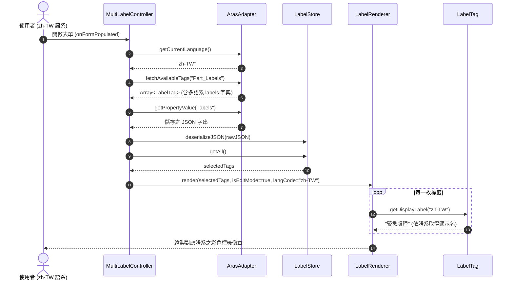
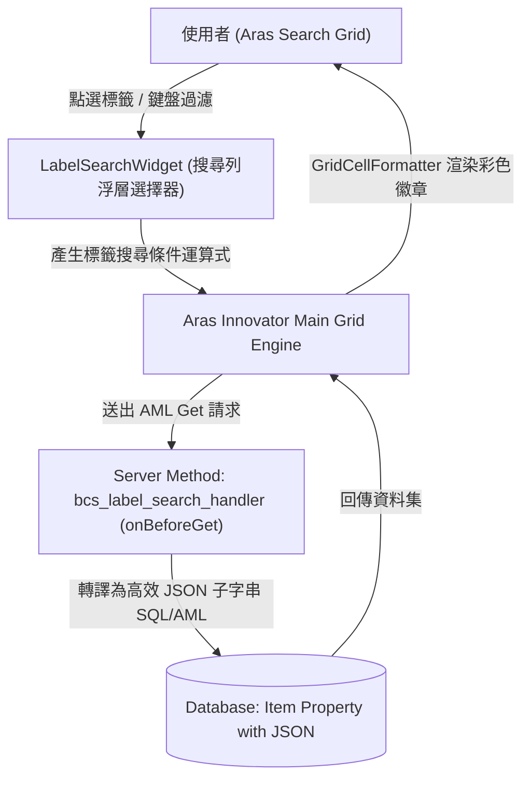
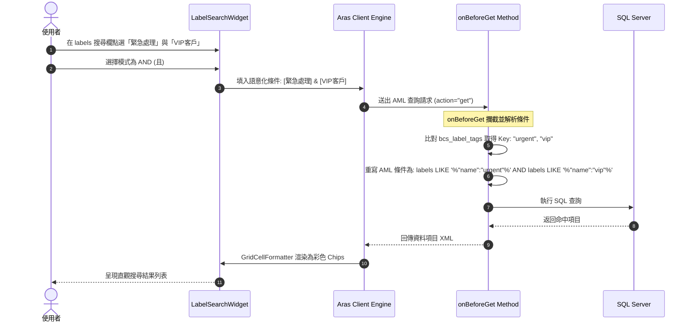
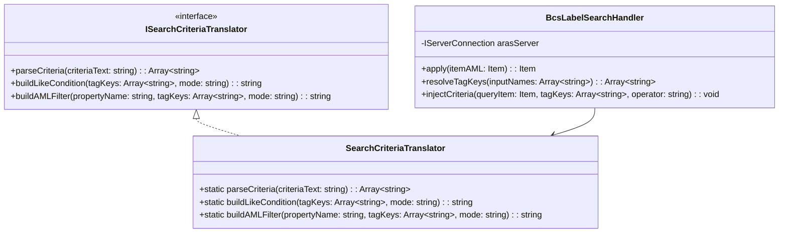
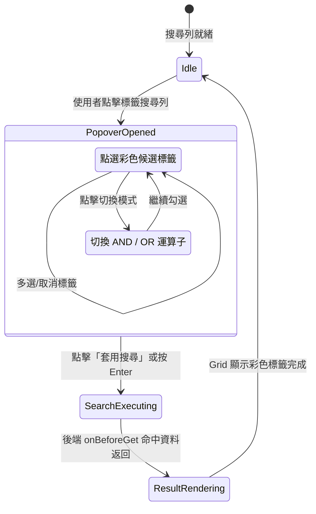

# Aras Innovator R36 - Client Form Multi-Label Field (`bcs_label`) 技術規格文件 (spec.md)

## 1. 需求與背景概述

### 1.1 需求說明
在 **Aras Innovator R36** 的 ItemType 中，使用者希望將標準的文字屬性（Text 或 String Property，例如 `labels` 或 `tags`）在 Client 端表單（Form）上擴充為「可選擇多筆標籤（Multi-Label / Tag Chips）」的視覺與互動元件。
標籤具備自訂顏色、多語系顯示與序號排序，並以新定義的 ItemType **`bcs_label`** 與關聯表 **`bcs_label_tags`** 作為標籤來源目錄。
**重要擴充**：標籤維護與表單顯示必須完整支援 **Aras 多語系能力 (Multilingual / I18N)**，能夠根據當前使用者登入的 Session 語系（例如 `zh-TW`, `zh-CN`, `en`, `ja`）動態呈現對應的標籤名稱，並在無該語系設定時安全退回（Fallback）。

### 1.2 標籤來源模型 (`bcs_label`)
1. **主表 (ItemType: `bcs_label`)**：
   - `name`: String(64) - 標籤分類目錄名稱（如 `Part_Labels`, `Project_Status`）。
2. **關聯細項 (Relationship ItemType: `bcs_label_tags`)**：
   - `sort_id`: Float - 排序序號。
   - `name`: String(32) - 標籤鍵值代碼（Key/ID，不隨語系變動）。
   - `label`: Multilingual String(64) - 支援多語系定義（`ml_string`）。在資料庫與 Client 端依登入語系提供不同語言文字。
   - `color`: Color/String(32) - 標籤徽章背景色（如 `#EF4444`, `#3B82F6`）。
3. **AML 匯入規範**：
   - 遵循 Aras Innovator 核心規範，所有 Item 的 `id` 屬性必須為合法的 32 碼十六進位字串（不包含連字號）。在執行 `action="add"` 建立 ItemType/Property 時，不應傳入非 hex 自訂字串，由系統自動分配 GUID。
   - 關聯模型（`RelationshipType`）建立時，底層關聯 ItemType 需直接嵌套於 `<relationship_id>` 內一併建立，不可獨立在外層建立一般 ItemType 再行關聯，以確保 Aras 核心引擎自動為其生成 `source_id` 等關聯專用系統欄位與外鍵約束。
   - **權限控制設定**：ItemType 建立時必須配置 `Allowed Permission`（指定 `is_default=1`，如系統內建之 `Default Access`）與 `ItemType Can Add`（授權如 `World` 身分），否則新增 Item 實例時將因缺少預設權限而被伺服器拒絕。
   - Schema 定義（ItemType/RelationshipType）與資料新增（Item Instance）分段套用，避免同批次執行時遇到快取尚未更新的問題。

### 1.3 資料儲存格式 (JSON 陣列字串，支援多語系結構)
在目標 ItemType 的文字屬性欄位中，儲存格式為標準 JSON 陣列字串。
為了使不同語言的使用者在開啟同一筆資料時皆能看見自己語系的標籤名稱，標籤資料封裝了 `labels` 多語系字典及預設 `label`：
```json
[
  {
    "name": "urgent",
    "label": "緊急處理",
    "labels": {
      "zh-TW": "緊急處理",
      "zh-CN": "紧急处理",
      "en": "Urgent Action"
    },
    "color": "#EF4444",
    "sort_id": 1.0
  },
  {
    "name": "design",
    "label": "設計中",
    "labels": {
      "zh-TW": "設計中",
      "zh-CN": "设计中",
      "en": "In Design"
    },
    "color": "#3B82F6",
    "sort_id": 2.0
  }
]
```

---

## 2. 系統架構與 S.O.L.I.D 設計

- **Single Responsibility Principle (單一職責原則)**：
  - `LabelTag`：實體模型，封裝單一標籤的色彩驗證、多語系解析 (`getDisplayLabel(langCode)`) 與 JSON 序列化。
  - `LabelStore`：狀態管理，維護已選標籤陣列、重複檢查、新增/刪除與 JSON 序列化。
  - `LabelRenderer`：負責 DOM 結構生成（Chips、色彩圓點、懸浮動態、搜尋下拉清單，顯示對應語系文字）。
  - `ArasAdapter`：適配 Aras Innovator Client API，負責：
    1. 取得當前使用者登入語系 (`aras.getSessionContext().getLanguageCode()`)。
    2. 透過 IOM 查詢 `bcs_label` 及其關聯的 `bcs_label_tags`（包含各語系值）。
    3. 透過 `handleItemChange` 寫入目標屬性。
  - `MultiLabelController`：調度控制器，統籌上述模組之生命週期與多語系動態切換。
- **Open/Closed Principle (開放封閉原則)**：
  支援可抽換之 Adapter（正式環境的 `ArasAdapter` 與測試環境的 `MockArasAdapter`），亦可擴充新增其他語系代碼對應。
- **Dependency Inversion Principle (依賴反向原則)**：
  Controller 依賴於 Adapter 抽象介面，不直接繫結全域 DOM 或硬編碼特定語系代碼。

---

## 3. Mermaid 圖表集

### 3.1 系統架構與多語系系統脈絡圖 (System Context)


### 3.2 模組關係圖 (Class Diagram)


### 3.3 多語系解析序列圖 (Sequence Diagram - Multilingual Display)


### 3.4 流程圖 (Flowchart - 多語系文字取得與 Fallback 邏輯)
```mermaid
flowchart TD
    Start([請求標籤顯示名稱]) --> CheckLang{labels 字典中是否有指定 langCode?}
    CheckLang -- 有且非空 --> ReturnLang[返回 labels[langCode]]
    CheckLang -- 無 --> CheckDefaultLabel{實體是否有預設 label 欄位?}
    CheckDefaultLabel -- 有且非空 --> ReturnLabel[返回 label]
    CheckDefaultLabel -- 無 --> CheckEn{labels 字典是否有 'en' 語系?}
    CheckEn -- 有 --> ReturnEn[返回 labels['en']]
    CheckEn -- 無 --> ReturnName[安全退回返回 name 鍵值代碼]
    ReturnLang --> End([輸出顯示文字])
    ReturnLabel --> End
    ReturnEn --> End
    ReturnName --> End
```

---

## 4. 多語系核心虛擬碼 (Pseudocode)

```typescript
class LabelTag {
    name: string;
    label: string;
    labels: Record<string, string>; // 多語系字典 e.g. { "zh-TW": "緊急", "en": "Urgent" }
    color: string;
    sort_id: number;

    getDisplayLabel(langCode: string = "zh-TW", fallbackLang: string = "en"): string {
        if (this.labels && typeof this.labels === "object") {
            if (this.labels[langCode]) return this.labels[langCode];
            // 語系代碼相容性匹配 (如 zh-TW 配對 zh)
            const baseLang = langCode.split("-")[0];
            if (this.labels[baseLang]) return this.labels[baseLang];
            if (this.labels[fallbackLang]) return this.labels[fallbackLang];
        }
        return this.label || this.name;
    }
}
```

---

## 5. Search 介面 Multi-Tags 輸入與模糊搜尋規格

### 5.1 需求與背景
在 Aras Innovator R36 的主網格搜尋（Main Grid Search / Simple Search）或搜尋對話框中：
1. 目標屬性欄位中儲存的是 JSON 陣列（例如包含 `[{"name":"urgent", "label":"緊急處理", ...}]`）。
2. 使用者需要在搜尋介面中：
   - 能夠以點選方式（浮層挑選面板）或文字輸入挑選標籤（例如選擇「緊急處理」）。
   - 支援輸入或挑選多筆標籤，並可設定搜尋條件關係為 **AND（同時包含所選標籤）** 或 **OR（包含任一標籤）**。
   - 支援跨語系模糊比對（無論使用者以中文「緊急處理」、代碼「urgent」或英文「Urgent」搜尋，皆能命中包含該標籤的項目）。
3. 搜尋結果 Grid 中，該文字欄位應由原始 JSON 字串自動轉換為彩色標籤徽章（Grid Cell Formatter），提供直觀清晰的檢視體驗。

### 5.2 搜尋架構設計與選型
- **前端搜尋輸入層 (`LabelSearchWidget`)**：
  在 Simple Search 的欄位輸入框旁掛載浮層按鈕或點擊彈出彩色標籤勾選浮層，讓使用者免去手動輸入 JSON 萬用字元的繁瑣。
- **後端轉譯層 (`bcs_label_search_handler` - onBeforeGet)**：
  目標 ItemType 掛載 `onBeforeGet` Server Method。
  當攔截到針對 `labels` 欄位的查詢時，解析標籤鍵值並將條件自動展開為標準高效的 SQL/AML 條件：
  - 單一標籤：「緊急處理」 -> `labels LIKE '%"name":"urgent"%'`
  - 多標籤 AND：「緊急處理」AND「VIP客戶」 -> `labels LIKE '%"name":"urgent"%' AND labels LIKE '%"name":"vip"%'`
  - 多標籤 OR：「緊急處理」OR「設計階段」 -> `(labels LIKE '%"name":"urgent"%' OR labels LIKE '%"name":"design"%')`
- **結果列表渲染層 (`GridCellFormatter`)**：
  在 Grid 渲染回調中將 JSON 字串解析為彩色 Badge。

---

## 6. Search 模組 Mermaid 圖表集

### 6.1 搜尋系統脈絡圖 (Search System Context)


### 6.2 搜尋轉譯序列圖 (Search Translation Sequence Diagram)


### 6.3 搜尋決策流程圖 (Search Logic Flowchart)
```mermaid
flowchart TD
    Start([收到查詢請求 (onBeforeGet)]) --> CheckProperty{搜尋條件是否包含 labels 欄位?}
    CheckProperty -- 否 --> PassThrough([直接放行原生查詢])
    CheckProperty -- 是 --> ExtractInput[擷取使用者輸入關鍵字或代碼]
    ExtractInput --> ParseTerms[依逗號或分號分割為標籤查詢項目]
    ParseTerms --> QueryCatalog[對齊 bcs_label_tags 目錄]
    QueryCatalog --> MatchKey[轉換為標籤唯一代碼 Key (如 urgent, vip)]
    MatchKey --> BuildClause[生成 JSON 子字串 LIKE 條件式]
    BuildClause --> RewriteAML[動態重寫當前 AML 之 criteria 節點]
    RewriteAML --> ExecuteQuery([放行轉譯後查詢])
```

### 6.4 後端關鍵類別圖 (Class Diagram - Server-side & Translator)


### 6.5 搜尋狀態圖 (Search State Diagram)


---

## 7. 後端 API / Method 介面設計 (AML & Controller 規劃)

### 7.1 Server Method: `bcs_label_search_handler` (C# .NET)
- **語言實作**：C# (.NET)。Aras Innovator 伺服器端環境原生執行。
- **預設運算邏輯**：**AND (交集)**，資料必須同時包含使用者所選的所有標籤。
- **觸發事件**：目標 ItemType (如 `Part`) 的 **`onBeforeGet`**。
- **輸入 (AML Request)**：
  ```xml
  <Item type="Part" action="get">
    <labels condition="like">*緊急處理*</labels>
  </Item>
  ```
- **轉譯後輸出 (Transformed AML)**：
  ```xml
  <Item type="Part" action="get">
    <!-- 動態展開為 JSON 屬性關鍵鍵值 LIKE 匹配 (AND 邏輯) -->
    <and>
      <labels condition="like">%"name":"urgent"%</labels>
    </and>
  </Item>
  ```
- **多標籤輸入範例 (AND 關係)**：
  ```xml
  <Item type="Part" action="get">
    <labels condition="like">*緊急處理,VIP重點*</labels>
  </Item>
  ```
  自動轉譯為：
  ```xml
  <Item type="Part" action="get">
    <and>
      <labels condition="like">%"name":"urgent"%</labels>
      <labels condition="like">%"name":"vip"%</labels>
    </and>
  </Item>
  ```

### 7.2 C# Server Method 撰寫與編譯規範
- **Aras Innovator Method Wrapper 機制**：
  Aras Innovator 伺服器在編譯 C# Method 時，會將 Method 編輯器中的程式碼自動封裝於 `ItemMethod.methodCode()` 內部執行。
- **程式碼撰寫規範**：
  1. **無須頂層 `using` 與 `namespace`**：Aras 平台已自動引用 `System`, `System.Collections.Generic`, `Aras.IOM` 等命名空間，在 Method 本體內撰寫頂層 `using` 會被 C# 編譯器視為 `using statement` 宣告而報錯。
  2. **直接撰寫方法體**：程式碼直接作為方法實體執行，入口直接使用 `this` (當前 Item) 與 `this.getInnovator()`。
  3. **確保所有路徑均有傳回值**：包含正常流程與例外捕捉區塊，必須確保皆返回 `Item`（如 `return this;` 或 `return inn.newError(...)`）。


