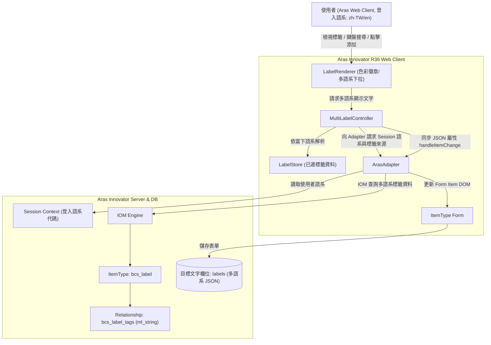
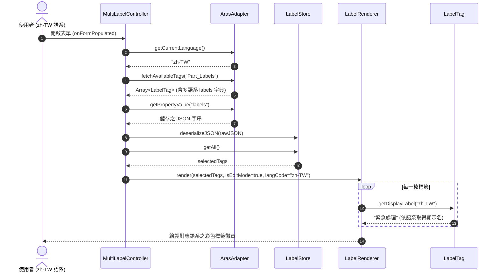
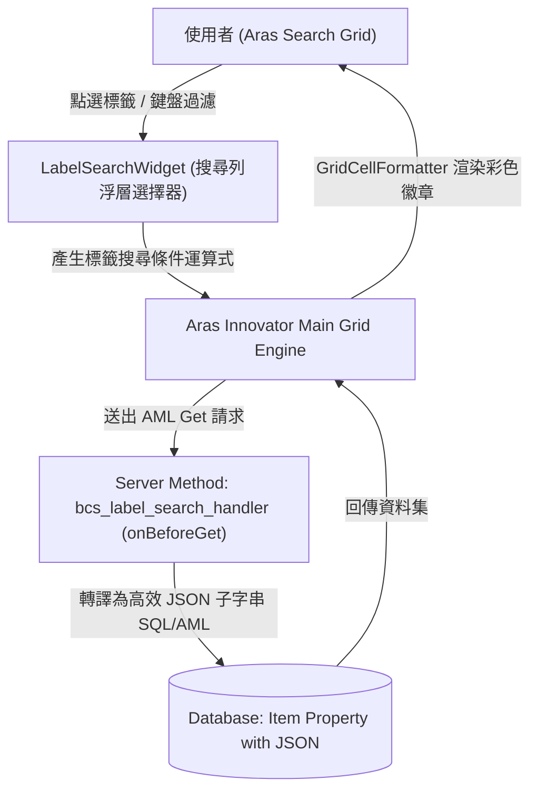
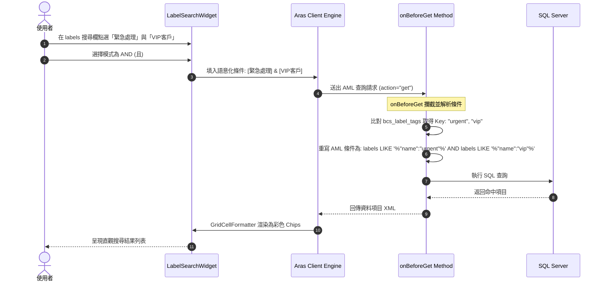
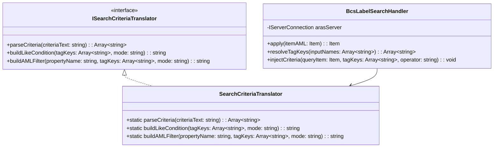
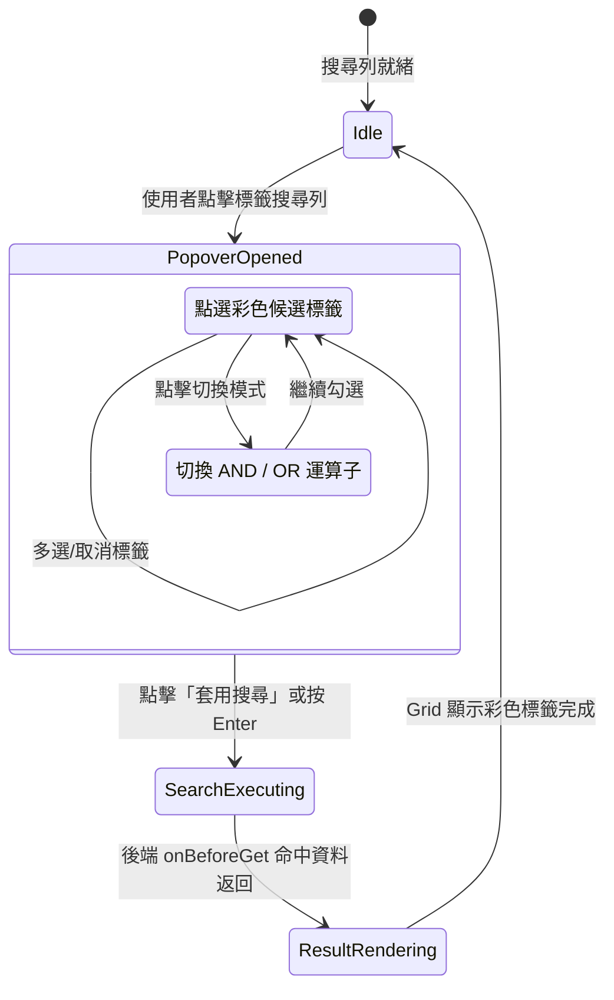
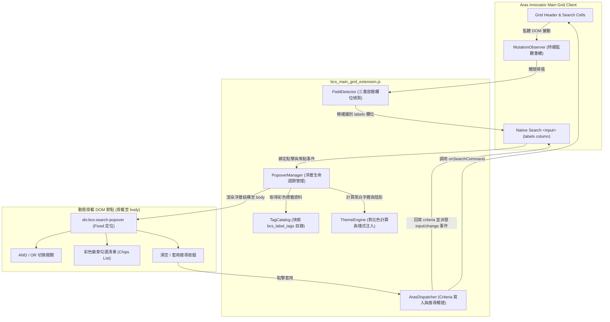
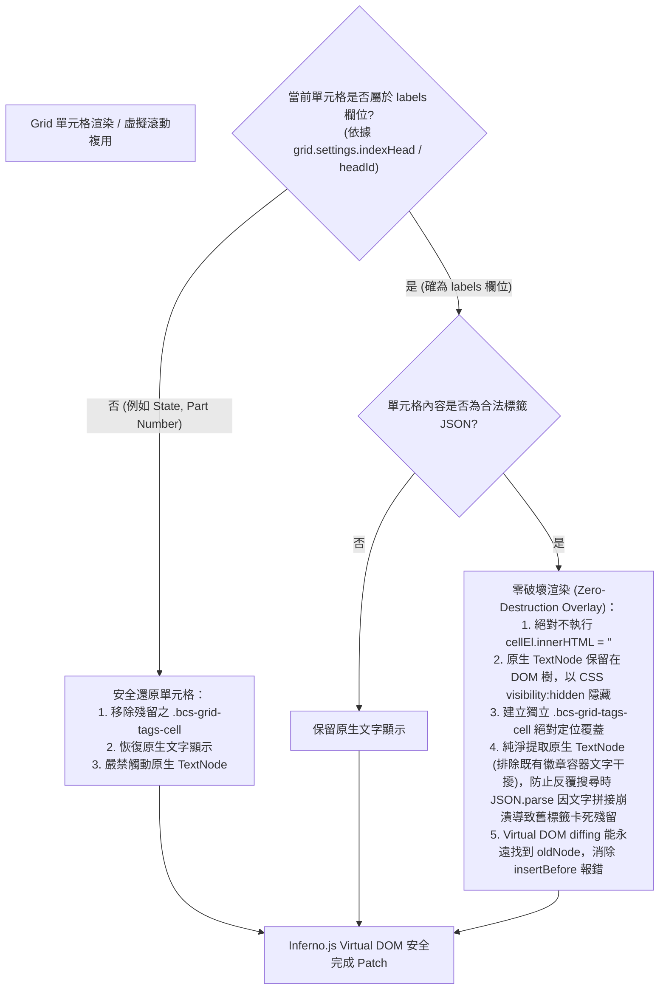

# Aras Innovator R36 - Client Form Multi-Label Field (`bcs_label`) 技術規格文件 (spec.md)

## 1. 需求與背景概述

### 1.1 需求說明
在 **Aras Innovator R36** 的 ItemType 中，使用者希望將標準的文字屬性（Text 或 String Property，例如 `labels` 或 `tags`）在 Client 端表單（Form）上擴充為「可選擇多筆標籤（Multi-Label / Tag Chips）」的視覺與互動元件。
標籤具備自訂顏色、多語系顯示與序號排序，並以新定義的 ItemType **`bcs_label`** 與關聯表 **`bcs_label_tags`** 作為標籤來源目錄。
**重要擴充**：標籤維護與表單顯示必須完整支援 **Aras 多語系能力 (Multilingual / I18N)**，能夠根據當前使用者登入的 Session 語系（例如 `zh-TW`, `zh-CN`, `en`, `ja`）動態呈現對應的標籤名稱，並在無該語系設定時安全退回（Fallback）。

### 1.2 標籤來源模型 (`bcs_label`)
1. **主表 (ItemType: `bcs_label`)**：
   - `name`: String(64) - 標籤分類目錄名稱（如 `Part_Labels`, `Project_Status`）。
2. **關聯細項 (Relationship ItemType: `bcs_label_tags`)**：
   - `sort_id`: Float - 排序序號。
   - `name`: String(32) - 標籤鍵值代碼（Key/ID，不隨語系變動）。
   - `label`: Multilingual String(64) - 支援多語系定義（`ml_string`）。在資料庫與 Client 端依登入語系提供不同語言文字。
   - `color`: Color/String(32) - 標籤徽章背景色（如 `#EF4444`, `#3B82F6`）。
3. **AML 匯入規範**：
   - 遵循 Aras Innovator 核心規範，所有 Item 的 `id` 屬性必須為合法的 32 碼十六進位字串（不包含連字號）。在執行 `action="add"` 建立 ItemType/Property 時，不應傳入非 hex 自訂字串，由系統自動分配 GUID。
   - 關聯模型（`RelationshipType`）建立時，底層關聯 ItemType 需直接嵌套於 `<relationship_id>` 內一併建立，不可獨立在外層建立一般 ItemType 再行關聯，以確保 Aras 核心引擎自動為其生成 `source_id` 等關聯專用系統欄位與外鍵約束。
   - **權限控制設定**：ItemType 建立時必須配置 `Allowed Permission`（指定 `is_default=1`，如系統內建之 `Default Access`）與 `ItemType Can Add`（授權如 `World` 身分），否則新增 Item 實例時將因缺少預設權限而被伺服器拒絕。
   - Schema 定義（ItemType/RelationshipType）與資料新增（Item Instance）分段套用，避免同批次執行時遇到快取尚未更新的問題。

### 1.3 資料儲存格式 (JSON 陣列字串，支援多語系結構)
在目標 ItemType 的文字屬性欄位中，儲存格式為標準 JSON 陣列字串。
為了使不同語言的使用者在開啟同一筆資料時皆能看見自己語系的標籤名稱，標籤資料封裝了 `labels` 多語系字典及預設 `label`：
```json
[
  {
    "name": "urgent",
    "label": "緊急處理",
    "labels": {
      "zh-TW": "緊急處理",
      "zh-CN": "紧急处理",
      "en": "Urgent Action"
    },
    "color": "#EF4444",
    "sort_id": 1.0
  },
  {
    "name": "design",
    "label": "設計中",
    "labels": {
      "zh-TW": "設計中",
      "zh-CN": "设计中",
      "en": "In Design"
    },
    "color": "#3B82F6",
    "sort_id": 2.0
  }
]
```

---

## 2. 系統架構與 S.O.L.I.D 設計

- **Single Responsibility Principle (單一職責原則)**：
  - `LabelTag`：實體模型，封裝單一標籤的色彩驗證、多語系解析 (`getDisplayLabel(langCode)`) 與 JSON 序列化。
  - `LabelStore`：狀態管理，維護已選標籤陣列、重複檢查、新增/刪除與 JSON 序列化。
  - `LabelRenderer`：負責 DOM 結構生成（Chips、色彩圓點、懸浮動態、搜尋下拉清單，顯示對應語系文字）。
  - `ArasAdapter`：適配 Aras Innovator Client API，負責：
    1. 取得當前使用者登入語系 (`aras.getSessionContext().getLanguageCode()`)。
    2. 透過 IOM 查詢 `bcs_label` 及其關聯的 `bcs_label_tags`（包含各語系值）。
    3. 讀取屬性透過 `aras.getItemProperty(document.item, propertyName)`（相容 `document.thisItem` 與 XMLNode），寫入屬性則採 `handleItemChange` 搭配 `aras.setItemProperty(document.item, ...)` 雙重同步，確保表單 Dirty 狀態標記與點擊 Save 時能確實寫入資料庫。
    4. **伺服器主動補查機制 (Auto Re-fetch)**：若 Form 上未放置原生 Text Field，Aras 載入表單時的 SELECT 查詢不會包含 `labels` 節點。當從表單 DOM 讀取為空且 Item 已有 ID 時，自動透過 `aras.applyItem` / IOM 發起查詢補查資料庫真實數值，確保在 View Mode 或解鎖重整時標籤徽章持續正確呈現。
    5. **後端直通持久化機制 (Direct Persistence)**：在標籤增刪時，除了通知表單骯髒標記，即刻透過 `aras.applyItem("<Item action='edit' version='0'>...")` 直通後端持久化，防止表單生命週期解鎖或重新抓取時因 Form 缺乏 Field 定義而遭遺漏。
  - `MultiLabelController`：調度控制器，統籌上述模組之生命週期與多語系動態切換。
- **Open/Closed Principle (開放封閉原則)**：
  支援可抽換之 Adapter（正式環境的 `ArasAdapter` 與測試環境的 `MockArasAdapter`），亦可擴充新增其他語系代碼對應。
- **Dependency Inversion Principle (依賴反向原則)**：
  Controller 依賴於 Adapter 抽象介面，不直接繫結全域 DOM 或硬編碼特定語系代碼。

---

## 3. Mermaid 圖表集

### 3.1 系統架構與多語系系統脈絡圖 (System Context)


### 3.2 模組關係圖 (Class Diagram)


### 3.3 多語系解析序列圖 (Sequence Diagram - Multilingual Display)


### 3.4 流程圖 (Flowchart - 多語系文字取得與 Fallback 邏輯)
```mermaid
flowchart TD
    Start([請求標籤顯示名稱]) --> CheckLang{labels 字典中是否有指定 langCode?}
    CheckLang -- 有且非空 --> ReturnLang[返回 labels[langCode]]
    CheckLang -- 無 --> CheckDefaultLabel{實體是否有預設 label 欄位?}
    CheckDefaultLabel -- 有且非空 --> ReturnLabel[返回 label]
    CheckDefaultLabel -- 無 --> CheckEn{labels 字典是否有 'en' 語系?}
    CheckEn -- 有 --> ReturnEn[返回 labels['en']]
    CheckEn -- 無 --> ReturnName[安全退回返回 name 鍵值代碼]
    ReturnLang --> End([輸出顯示文字])
    ReturnLabel --> End
    ReturnEn --> End
    ReturnName --> End
```

---

## 4. 多語系核心虛擬碼 (Pseudocode)

```typescript
class LabelTag {
    name: string;
    label: string;
    labels: Record<string, string>; // 多語系字典 e.g. { "zh-TW": "緊急", "en": "Urgent" }
    color: string;
    sort_id: number;

    getDisplayLabel(langCode: string = "zh-TW", fallbackLang: string = "en"): string {
        if (this.labels && typeof this.labels === "object") {
            if (this.labels[langCode]) return this.labels[langCode];
            // 語系代碼相容性匹配 (如 zh-TW 配對 zh)
            const baseLang = langCode.split("-")[0];
            if (this.labels[baseLang]) return this.labels[baseLang];
            if (this.labels[fallbackLang]) return this.labels[fallbackLang];
        }
        return this.label || this.name;
    }
}
```

---

## 5. Search 介面 Multi-Tags 輸入與模糊搜尋規格

### 5.1 需求與背景
在 Aras Innovator R36 的主網格搜尋（Main Grid Search / Simple Search）或搜尋對話框中：
1. 目標屬性欄位中儲存的是 JSON 陣列（例如包含 `[{"name":"urgent", "label":"緊急處理", ...}]`）。
2. 使用者需要在搜尋介面中：
   - 能夠以點選方式（浮層挑選面板）或文字輸入挑選標籤（例如選擇「緊急處理」）。
   - 支援輸入或挑選多筆標籤，並可設定搜尋條件關係為 **AND（同時包含所選標籤）** 或 **OR（包含任一標籤）**。
   - 支援跨語系模糊比對（無論使用者以中文「緊急處理」、代碼「urgent」或英文「Urgent」搜尋，皆能命中包含該標籤的項目）。
3. 搜尋結果 Grid 中，該文字欄位應由原始 JSON 字串自動轉換為彩色標籤徽章（Grid Cell Formatter），提供直觀清晰的檢視體驗。

### 5.2 搜尋架構設計與選型
- **前端搜尋輸入層 (`LabelSearchWidget`)**：
  在 Simple Search 的欄位輸入框旁掛載浮層按鈕或點擊彈出彩色標籤勾選浮層，讓使用者免去手動輸入 JSON 萬用字元的繁瑣。
- **後端轉譯層 (`bcs_label_search_handler` - onBeforeGet)**：
  目標 ItemType 掛載 `onBeforeGet` Server Method。
  當攔截到針對 `labels` 欄位的查詢時，解析標籤鍵值並將條件自動展開為標準高效的 SQL/AML 條件：
  - 單一標籤：「緊急處理」 -> `labels LIKE '%"name":"urgent"%'`
  - 多標籤 AND：「緊急處理」AND「VIP客戶」 -> `labels LIKE '%"name":"urgent"%' AND labels LIKE '%"name":"vip"%'`
  - 多標籤 OR：「緊急處理」OR「設計階段」 -> `(labels LIKE '%"name":"urgent"%' OR labels LIKE '%"name":"design"%')`
- **結果列表渲染層 (`GridCellFormatter`)**：
  在 Grid 渲染回調中將 JSON 字串解析為彩色 Badge。

### 5.3 方案 A：Main Search 標籤搜尋列彩色多選浮層卡片 (Popover Widget) 詳細規格
為了解決使用者的問題（在 Main Search 網格搜尋框中輸入 label 時，希望能如同 Form 表單一般直觀點選彩色標籤），採用「方案 A：點擊搜尋框彈出彩色標籤多選浮層卡片 (Popover)」作為核心實作方案。

#### 1. 互動與視覺體驗 (與 Form 保持一致)
- **浮層結構 (Popover Card)**：
  - **標題區 (Header)**：顯示「標籤篩選過濾」及「且 (AND) / 或 (OR)」模式切換開關（預設為 AND）。
  - **標籤清單區 (List)**：以垂直或網格流式列出所有可用標籤，每個標籤均呈現：
    - 核取方塊 (`<input type="checkbox">`)
    - 與 Form 完全一致的彩色藥丸徽章（背景色採 `bcs_label_tags.color`，文字自動計算黑/白最佳對比色）。
    - 依使用者 Session 語系動態顯示之多語系標籤文字（例如繁中「緊急處理」）。
  - **操作控制區 (Footer)**：
    - 「清空 (Clear)」按鈕：清除所有已選標籤並清空搜尋欄位。
    - 「套用搜尋 (Apply)」按鈕：確認所選項目，將條件回填至搜尋框，並自動觸發 Aras 主搜尋。
- **觸發與收合機制**：
  - **開啟觸發**：使用者點擊搜尋列「標記」欄位之 `<input>`，或點擊輸入框右側的標籤小圖示按鈕，即自動開啟浮層。
  - **收合觸發**：使用者點擊浮層外部任意區域（Click Outside）或按下鍵盤 `Escape` 鍵，浮層平滑關閉。

#### 2. Aras HyperGrid DOM 適配與防破壞規範
- **非侵入式結構**：
  - 嚴禁置換或搬移 Aras 原生 `<input>`（避免破壞 Aras Grid 的虛擬滾動與欄寬排版計算）。
  - 搜尋小圖示按鈕採同層絕對定位（Overlay / Sibling 定位），不增加額外 wrapper 節點影響 Grid 樣式。
- **防止浮層裁切 (Overflow Clipping Prevention)**：
  - Popover DOM 節點直接掛載於最頂層 `document.body`，採用 `position: fixed` 與極高之 `z-index: 99999`。
  - 根據目標 `<input>` 的 `getBoundingClientRect()` 動態計算 `top` 與 `left`，徹底杜絕因表格容器的 `overflow: hidden` 或 `overflow: auto` 導致浮層被裁切的問題。

#### 3. 智慧欄位探測機制 (Field Detection Strategy)
由於 Aras Innovator 各版本 (R12/R2023/R36) 的 Main Grid DOM 類別與屬性略有差異，搜尋列之「標記」欄位採用三道容錯偵測：
1. **表頭標題比對**：檢查表頭 cell（`.aras-grid-header-cell`, `th[role='columnheader']`, `.aras-grid-head-cell`）文字是否包含「標記」、「標籤」、「labels」或「Labels」。
2. **屬性特徵比對**：檢查單元格之屬性（`data-index`, `data-key`, `data-head-id`）是否對齊 `labels`。
3. **資料行特徵輔助**：若表頭結構受自訂樣式阻隔，透過掃描下方資料列單元格內容是否包含 `[{"name":` 特徵，反向鎖定所屬欄位之 Column Index，確保精準掛載。

#### 4. 四層深度查詢模型同步 (Deep Query Sync Architecture)
在 Aras Innovator 的主搜尋網格 (Main Search Grid) Simple Search 模式中，僅透過 JavaScript 修改 DOM `<input>.value` 並派發 synthetic DOM event，無法保證 Aras 內部查詢模型（`currQryItem` / `searchContainer` / `grid.head`）同步更新。若查詢模型未更新，Aras 送出的 AML 將仍停留在舊條件（或完全遺漏 `labels` 條件，退回全表查詢），導致搜尋框顯示正確但搜尋結果錯誤（例如顯示了前次搜尋包含「緊急處理」的項目）。
為此，方案 A 實施四層深度同步：
- **第一層 (DOM 層)**：賦值 `input.value = criteriaText` 並派發原生事件鏈 (`input`, `change`, `blur`)。
- **第二層 (QryItem 核心層)**：跨視窗查找當前網格的 `currQryItem`（或 `searchContainer.searchMode.currQryItem`），直接呼叫 `setProperty("labels", "*" + criteriaText + "*")` 與 `setPropertyAttribute("labels", "condition", "like")`。清空時呼叫 `removeProperty("labels")`。
- **第三層 (SearchMode 控制層)**：若 `searchContainer.searchMode` 具備 `setSearchCriteria` 介面，同步傳入最新條件。
- **第四層 (Grid Head 快取層)**：若存在 `window.grid.head` (ArasModules.Grid / HyperGrid Map)，遍歷定位 `labels` 欄位定義，更新其 `searchValue` 屬性，杜絕虛擬滾動與重繪時被舊快取覆蓋。

---

## 6. Search 模組 Mermaid 圖表集

### 6.1 搜尋系統脈絡圖 (Search System Context)


### 6.2 搜尋轉譯序列圖 (Search Translation Sequence Diagram)


### 6.3 搜尋決策流程圖 (Search Logic Flowchart)
```mermaid
flowchart TD
    Start([收到查詢請求 (onBeforeGet)]) --> CheckProperty{搜尋條件是否包含 labels 欄位?}
    CheckProperty -- 否 --> PassThrough([直接放行原生查詢])
    CheckProperty -- 是 --> ExtractInput[擷取使用者輸入關鍵字或代碼]
    ExtractInput --> ParseTerms[依逗號或分號分割為標籤查詢項目]
    ParseTerms --> QueryCatalog[對齊 bcs_label_tags 目錄]
    QueryCatalog --> MatchKey[轉換為標籤唯一代碼 Key (如 urgent, vip)]
    MatchKey --> BuildClause[生成 JSON 子字串 LIKE 條件式]
    BuildClause --> RewriteAML[動態重寫當前 AML 之 criteria 節點]
    RewriteAML --> ExecuteQuery([放行轉譯後查詢])
```

### 6.4 後端關鍵類別圖 (Class Diagram - Server-side & Translator)


### 6.5 搜尋狀態圖 (Search State Diagram)


### 6.6 方案 A 模組關係圖 (Module Relationships)


### 6.7 方案 A 搜尋列掛載與互動流程圖 (Flowchart)
```mermaid
flowchart TD
    Start([啟動 Grid 擴充掃描]) --> GetFrames[遞迴取得所有 iframe 視窗]
    GetFrames --> CheckGrid{視窗是否包含 aras-grid 或網格元件?}
    CheckGrid -- 否 --> NextFrame([跳過至下一視窗])
    CheckGrid -- 是 --> DetectCol[執行欄位偵測: 標記 / labels]
    
    DetectCol --> HeaderMatch{表頭文字包含標記/labels?}
    HeaderMatch -- 是 --> FoundCol[鎖定目標 Column Index]
    HeaderMatch -- 否 --> AttrMatch{單元格屬性為 labels?}
    AttrMatch -- 是 --> FoundCol
    AttrMatch -- 否 --> DataRowMatch{資料行包含 JSON 特徵?}
    DataRowMatch -- 是 --> FoundCol
    DataRowMatch -- 否 --> EndScan([未找到標記欄位])

    FoundCol --> FindInput[取得該欄位之搜尋 input]
    FindInput --> CheckAttached{是否已掛載 Popover?}
    CheckAttached -- 是 --> ObserveDOM[建立 MutationObserver 守護]
    CheckAttached -- 否 --> BindTrigger[綁定 Click / Focus / 圖示按鈕]
    
    BindTrigger --> UserClick[/使用者點擊搜尋框或標籤圖示/]
    UserClick --> CalcPos[依 input.getBoundingClientRect 計算定位]
    CalcPos --> RenderTags[繪製多語系彩色徽章清單與 Checkbox]
    RenderTags --> ShowPopover[顯示浮層 (z-index: 99999)]
    
    ShowPopover --> UserAction{使用者操作}
    UserAction -- 勾選標籤 --> UpdateSelected[更新選取狀態並高亮項目]
    UserAction -- 切換模式 --> ToggleMode[切換 AND / OR 運算子]
    UserAction -- 點擊清空 --> ClearAll[清空已選標籤與輸入框]
    UserAction -- 點擊外部/按 Esc --> HidePopover[關閉浮層]
    
    UserAction -- 點擊套用搜尋 --> ApplyCriteria[組合條件字串: 標籤1, 標籤2]
    ApplyCriteria --> SyncDOM[1. 更新原生 input.value 與派發事件鏈]
    SyncDOM --> SyncQryItem[2. 跨視窗注入 currQryItem.setProperty]
    SyncQryItem --> SyncSearchMode[3. 呼叫 searchContainer.setSearchCriteria]
    SyncSearchMode --> SyncGridHead[4. 更新 grid.head colDef.searchValue]
    SyncGridHead --> TriggerArasSearch[觸發 Aras 主搜尋 (onSearchCommand)]
    TriggerArasSearch --> HidePopover
```

### 6.8 Virtual DOM 防崩潰渲染架構 (Virtual DOM Safety Architecture)
為徹底消除 Aras Innovator HyperGrid (Inferno.js) 在欄位拖拉、調整欄寬與虛擬滾動時引發的 `NotFoundError: Failed to execute 'insertBefore' on 'Node'` 與單元格錯位問題（如 `State` 欄位被彩化覆蓋），規範採用以下三層防護：



### 6.9 方案 A 前端核心虛擬碼 (Pseudocode)
```typescript
/**
 * 方案 A 核心演算法虛擬碼 (含 Virtual DOM 零破壞渲染與四層深度同步)
 */
function attachLabelSearchPopover(targetDocument: Document): void {
    // 1. 智慧探測標記欄位索引
    let labelsColIndex = findLabelsColumnIndex(targetDocument);
    if (labelsColIndex === null) return;

    // 2. 獲取該欄位的原生搜尋輸入框
    let searchInput = getSearchInputByColumnIndex(targetDocument, labelsColIndex);
    if (!searchInput || searchInput._bcsPopoverBound) return;
    searchInput._bcsPopoverBound = true;

    // 3. 建立或取得共用 Popover DOM (掛載於 document.body，避免 overflow 裁切)
    let popover = getOrCreateGlobalPopover(targetDocument);

    // 4. 事件綁定 (非侵入式，保留原生 input)
    searchInput.addEventListener("click", (evt) => {
        openPopover(popover, searchInput);
    });
    searchInput.addEventListener("focus", (evt) => {
        openPopover(popover, searchInput);
    });

    // 5. 套用搜尋回調 (四層深度同步)
    popover.onApply = (selectedTagKeys: string[], matchMode: "AND" | "OR") => {
        const displayLabels = selectedTagKeys.map(key => getTagDisplayLabel(key));
        const criteriaText = displayLabels.join(matchMode === "OR" ? " | " : ", ");
        
        // 第一層：DOM 賦值與事件派發
        searchInput.value = criteriaText;
        searchInput.dispatchEvent(new Event("input", { bubbles: true }));
        searchInput.dispatchEvent(new Event("change", { bubbles: true }));
        searchInput.dispatchEvent(new KeyboardEvent("keydown", { bubbles: true, key: "Enter", keyCode: 13 }));
        
        // 第二層至第四層：跨視窗深度模型同步 (QryItem, SearchMode, GridHead)
        const win = targetDocument.defaultView || window;
        syncArasQueryState(win, criteriaText);
        
        // 觸發 Aras 主搜尋
        triggerArasSearchCommand(targetDocument);
        popover.hide();
    };
}
```

---

## 7. 後端 API / Method 介面設計 (AML & Controller 規劃)

### 7.1 Server Method: `bcs_label_search_handler` (C# .NET)
- **語言實作**：C# (.NET)。Aras Innovator 伺服器端環境原生執行。
- **預設運算邏輯**：**AND (交集)**，資料必須同時包含使用者所選的所有標籤。
- **觸發事件**：目標 ItemType (如 `Part`) 的 **`onBeforeGet`**。
- **輸入 (AML Request)**：
  ```xml
  <Item type="Part" action="get">
    <labels condition="like">*緊急處理*</labels>
  </Item>
  ```
- **轉譯後輸出 (Transformed AML)**：
  ```xml
  <Item type="Part" action="get">
    <!-- 動態展開為 JSON 屬性關鍵鍵值 LIKE 匹配 (AND 邏輯) -->
    <and>
      <labels condition="like">%"name":"urgent"%</labels>
    </and>
  </Item>
  ```
- **多標籤輸入範例 (AND 關係)**：
  ```xml
  <Item type="Part" action="get">
    <labels condition="like">*緊急處理,VIP重點*</labels>
  </Item>
  ```
  自動轉譯為：
  ```xml
  <Item type="Part" action="get">
    <and>
      <labels condition="like">%"name":"urgent"%</labels>
      <labels condition="like">%"name":"vip"%</labels>
    </and>
  </Item>
- **全語系雙重快取標籤目錄解析演算法 (Multilingual Tag Catalog Match)**：
  - **語系中立全域加載**：查詢目錄時加入 `language="*"` 屬性，並遍歷 XML 子節點 `<label xml:lang="...">`，將所有語系文字（繁中、簡中、英文）均映射至對應的唯一標籤 Key（如 `vip`），避免因客戶端使用英文介面登入而比對失效。
  - **雙重安全查詢 (Dual-Query Fallback)**：先嘗試以 `bcs_label_tags` 直接查詢；若因權限或關聯約束查無結果，立即自動切換至父表 `bcs_label ("Part_Labels")` 進行 Relationship 關聯補查。
  - **精確代碼匹配防漏**：解析出鍵值後，一律轉譯為針對 JSON 結構之唯一代碼模糊匹配（`labels LIKE '%"name":"<key>"%'`），杜絕多重 `<or>` 結構引發 SQL Server 條件解析錯誤或空查詢誤傳。

- **Aras Innovator Method Wrapper 機制**：
  Aras Innovator 伺服器在編譯 C# Method 時，會將 Method 編輯器中的程式碼自動封裝於 `ItemMethod.methodCode()` 內部執行。
- **程式碼撰寫規範**：
  1. **無須頂層 `using` 與 `namespace`**：Aras 平台已自動引用 `System`, `System.Collections.Generic`, `Aras.IOM` 等命名空間，在 Method 本體內撰寫頂層 `using` 會被 C# 編譯器視為 `using statement` 宣告而報錯。
  2. **直接撰寫方法體**：程式碼直接作為方法實體執行，入口直接使用 `this` (當前 Item) 與 `this.getInnovator()`。
  3. **確保所有路徑均有傳回值**：包含正常流程與例外捕捉區塊，必須確保皆返回 `Item`（如 `return this;` 或 `return inn.newError(...)`）。

### 7.3 Client Method: `bcs_main_grid_extension` (JavaScript)
- **語言實作**：Vanilla JavaScript (Client-side)，相容 Aras R36 Monaco/TypeScript 語法檢查器（支援 `// @ts-nocheck` 與完整 JSDoc 型別）。
- **架構特點與事件掛載途徑**：
  > [!IMPORTANT]
  > **重要概念**：ItemType 的 `Client Events` 頁籤僅提供項目生命週期事件（`OnBeforeNew`, `OnNew`, `OnAfterNew`, `OnShowItem`），**無主網格的 `onLoad` 選項**。
  > 主搜尋網格 (Main Search Grid) 的自訂擴充建議採用以下三種標準途徑之一：

  1. **途徑一（官方首選！100% 全自動零手動：CUI CommandBarSection Init Method）**：
     - **運作原理**：利用 Aras R36 核心之 Configurable User Interface (CUI)。當使用者於 TOC 點擊開啟主搜尋網格（Main Grid）時，工具列在初始化階段自動呼叫此 Method，瞬間完成單元格彩化與搜尋列按鈕掛載，並於頂層視窗常駐守護程序，完全無需使用者手動點擊 Action！
     - **設定方式**：
       - 前往 **Administration > Configuration > CommandBarSection**。
       - 開啟主搜尋工具列對應的 Section：`com.aras.innovator.cui_default.mwt_main_grid_toolbar`（全系統通用）或目標 ItemType 的專屬主網格工具列。
       - 在 **Command Bar Items** 頁籤新增一個按鈕（或隱藏按鈕），將其 **Init Method** 設定為 `bcs_main_grid_extension`。
       - 儲存後，任何使用者只要開啟主搜尋網格，擴充功能即刻 100% 全自動就緒！
  2. **途徑二（手動切換/隨選按鈕：ItemType Action 動作）**：
     - 在目標 ItemType（如 `Part`）的 **Actions** 頁籤中新增動作 `bcs_main_grid_extension`，提供使用者在特定情境下隨時手動點擊重整或啟用。
  3. **途徑三（開發即時預覽：瀏覽器 Console 執行）**：
     - 在 Main Search 網格畫面按 `F12`，在 Console 貼上 `bcs_main_grid_extension.js` 代碼執行，即刻彩化網格並掛載搜尋框。
- **職責說明**：
  1. **MutationObserver 監聽器**：監控 Main Grid 單元格 DOM，自動偵測含 `[{"name":` 開頭之 JSON 文字，即時彩化為高對比深/淺底圓角彩色徽章 (Chips)，徹底解決 JSON 裸露難讀問題。
  2. **搜尋列選擇器 (Popover Widget)**：探測搜尋列「標記」欄位之輸入框，動態掛載標籤挑選按鈕與浮層，支援勾選多個標籤與 AND/OR 條件切換，點選套用時自動觸發後端 `bcs_label_search_handler` 檢索。


